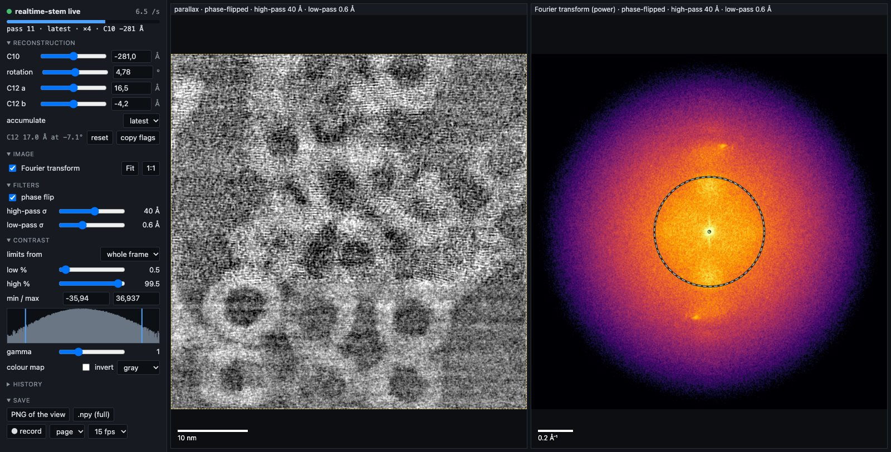

# realtime-stem

> **About this folder.** realtime-stem 3.0.0: real-time parallax / tilt-corrected bright-field
> (tcBF) reconstruction for 4D-STEM on a DECTRIS ARINA, with a browser viewer that can fine-tune
> the reconstruction while the scan runs. 3.0.0 runs on **Holoscan SDK 5** and receives the
> frames through this repository's shared ingest ([`holoscan_pipeline/`](../holoscan_pipeline/),
> [`dectris/`](../dectris/)), over **ZMQ** (compressed) or **RDMA** (uncompressed, straight into
> GPU memory). The Holoscan 4 version (2.2.0, the one used in the first live sessions in October
> 2026) still builds from this folder with its own ingest (`operators/`); its history and the
> recorded sessions are in
> [kucukogluberk/EM_Realtime_Processing](https://github.com/kucukogluberk/EM_Realtime_Processing)
> (tag `v2.2.0`). Background: [#9](https://github.com/electronmicroscopy/live4d/issues/9).
> Run every command below from this folder unless it says otherwise.

This program makes a parallax (tcBF) image **while the scan is running**. The ARINA detector
sends its frames to an NVIDIA GPU, and every frame is added to the image as soon as it arrives.
You watch the image fill in, in a browser. It keeps up with the ARINA at full speed (120,000
frames per second, 2×2 binned).



In the browser you can:

- turn on the **phase flip**, high-pass and low-pass filters, and the **Fourier transform** of
  what is on screen;
- **fine-tune the defocus, the rotation and the astigmatism** (C10, rotation, C12) while the scan
  runs. The values you started with remain the target for the microscope's knobs;
- save a PNG, the full image as `.npy`, or **record a video** of the page.

The same processing runs on a laptop without a detector or an NVIDIA GPU, on recorded or
simulated scans (see "Try it without a detector").

More detail: [`docs/GUIDE.md`](docs/GUIDE.md) (the full guide),
[`docs/WORKFLOWS.md`](docs/WORKFLOWS.md) (from a recording to a live demo: calibration, offline
reconstruction, looping a scan, a focus-walk demo) and [`docs/CLI.md`](docs/CLI.md) (every
option).

## Which image, which transport

There are two Docker images. Both run the same reconstruction and the same viewer; only the way
the frames come in differs.

| | Holoscan 5 image (recommended) | Holoscan 4 image (2.2.0) |
|---|---|---|
| Dockerfile | `docker/Dockerfile.hsdk5`, built from the **repository root** | `docker/Dockerfile`, built from this folder |
| Transports | `--transport zmq` or `--transport rdma` | ZMQ only |
| NVIDIA driver | CUDA 13 (driver 580 or newer) | CUDA 12 or newer |
| GPUs | Ampere (RTX 30xx, A6000), Ada, Hopper, Blackwell (RTX PRO 6000) | A100, Ampere, Ada, Hopper; **not Blackwell** (its PyTorch has no Blackwell kernels) |
| Frame type | uint16 only (the ARINA's fast scans) | uint16 and uint32 |
| Tested | RTX PRO 6000 Blackwell, ARINA over RDMA; ZMQ with replays | RTX 6000 Ada, ARINA over ZMQ |

The two transports:

| | `--transport zmq` (the default) | `--transport rdma` |
|---|---|---|
| How | the DCU's Stream2 over TCP (ZeroMQ), `--n-connections 3` | the DCU's RDMA stream (imagemux) into a ring in GPU memory |
| Compression | **`bslz4` on** (LZ4); the GPU unpacks the frames | **off** (`none`); the RDMA receiver refuses compressed frames |
| DCU settings | `stream/mode` `enabled`, `stream/format` `cbor`, `detector/compression` `bslz4` | `bstream/mode` `cbor-rdma`, `detector/compression` `none` |
| Network | any network link to the DCU, 10 Gbit/s or faster for 120 kHz | an RDMA-capable card (RoCE, e.g. ConnectX) on the DCU's RDMA network |

The compression is set on the DCU, not in this program, so **the DCU's compression must match the
transport you choose.** A mismatch stops the run with an error that says so.

## What is where

```
realtime_stem/        the Python package
  apps/run.py           the program you run (with --viewer-port it also serves the viewer)
  apps/control.py       live tuning from the viewer
  ingest/               receives the detector frames
    hsdk5_graph.py        Holoscan 5: the shared ZMQ / RDMA receivers → the reconstruction
    holoscan_graph.py     Holoscan 4: this folder's operators → the reconstruction
    python_ingest.py      no Holoscan: CPU decode, for laptops and recordings
  processing/parallax/  the parallax / tcBF reconstruction
  streaming/            publishes the live image; web/ is the browser viewer
operators/            the Holoscan 4 image's C++/CUDA frame receiver and GPU decompressor
docker/Dockerfile.hsdk5  builds the Holoscan 5 image (from the repository root)
docker/Dockerfile        builds the Holoscan 4 image (from this folder)
examples/             matplotlib viewer, notebook, sample recording
tools/                detector setup, stream recorder, replay (ZMQ and RDMA), simulator,
                      geometry calibration, looping and refocusing a recording
scripts/              installation check, demos, the standard session analysis
tests/                unit tests
```

The Holoscan 5 image compiles the receivers from [`../holoscan_pipeline/`](../holoscan_pipeline/)
(`ZmqRxOp`, `DecompressGpuOp`, `RdmaRxOp`) and installs [`../dectris/`](../dectris/) (the RDMA
connection). Recorded sessions and their analysis (Gd₂O₃ nanoparticles, an Au grating) are in
[EM_Realtime_Processing/sessions](https://github.com/kucukogluberk/EM_Realtime_Processing/tree/v2.2.0/sessions).

## Try it without a detector

On a laptop (CPU, Apple silicon or an NVIDIA GPU), without Docker. This simulates a 256×256 scan
(about a minute), reconstructs it and serves the viewer:

```bash
python3 -m venv .venv && source .venv/bin/activate
pip install -e ".[local,viz,replay]"
python -m tools.simulate_4dstem --scan 256 256 --format dstream --out out/sim256
python -m realtime_stem.apps.run --ingest python --source out/sim256.dstream $(cat out/sim256.flags) \
    --accumulate latest --viewer-port 8050 --out-dir out
```

Open http://127.0.0.1:8050. The viewer stays up after the replay: change C10 or the rotation in
the Reconstruction section and the image is re-rendered from the frames it holds. Ctrl-C saves the
tuned image to `out/` and prints the tuned flags.

`scripts/run_replay_demo.sh` does the same in the Holoscan 4 image on the GPU. To test the
Holoscan 5 image without a detector, see "Testing the Holoscan 5 image without a detector" below.
[`docs/WORKFLOWS.md`](docs/WORKFLOWS.md) streams a recording in a loop, as a microscope scanning
the same area would, and walks it through focus.

## What you need

- **A Linux PC with an NVIDIA GPU** and a network connection to the ARINA's detector control
  unit (the DCU). We call it the *processing PC*.
- **An NVIDIA driver** for CUDA 13 (Holoscan 5 image) or CUDA 12 (Holoscan 4 image). Run
  `nvidia-smi`: it shows the `CUDA Version` the driver supports.
- **Docker** and the **NVIDIA Container Toolkit**, so that Docker can use the GPU.
- **For RDMA only:** an RDMA network card on the DCU's RDMA network (`ibv_devinfo` shows its
  device, e.g. `mlx5_0`, with `state: PORT_ACTIVE`). Frames go straight into GPU memory when the
  host has GPUDirect RDMA (the `nvidia_peermem` kernel module: `lsmod | grep nvidia_peermem`);
  without it, use `--rdma-ring-memory host_mapped`.
- **Python 3.10 or newer**, for the detector commands (and the optional standalone viewers).
- **A web browser**, on the processing PC or on another computer (see "Watching from another
  computer").
- **Disk space:** the NVIDIA base images are large. Keep several tens of GB free.
- GPUs missing from the image's list (older ones such as V100 or T4, or A100 for the Holoscan 5
  image) need an extra build option: `--build-arg CUDA_ARCHITECTURES="…"` (see
  [`docs/GUIDE.md`](docs/GUIDE.md), "Host requirements").

## Install

Do this once, on the processing PC.

**1. Check that Docker can see the GPU.**

```bash
docker run --rm --gpus all ubuntu nvidia-smi
```

It must print your GPU. If it fails, install or fix the NVIDIA Container Toolkit first.

**2. Get the code and go into this folder.**

```bash
git clone https://github.com/electronmicroscopy/live4d.git
cd live4d/realtime_stem_parallax
```

**3. Build the Docker image.** The first build downloads NVIDIA's base image (large; this can take
a while, depending on your network) and then compiles the GPU code (a few minutes).

The Holoscan 5 image (ZMQ and RDMA) is built from the repository root, one folder up:

```bash
(cd .. && docker build -f realtime_stem_parallax/docker/Dockerfile.hsdk5 -t realtime-stem:hsdk5 .)
```

The Holoscan 4 image (ZMQ only; not on Blackwell GPUs) is built from this folder:

```bash
docker build -t realtime-stem:latest -f docker/Dockerfile .
```

The commands below use `realtime-stem:hsdk5`. With the Holoscan 4 image, use
`realtime-stem:latest` and leave out the `--transport` and `--rdma-…` options.

**4. Install the host tools** (the detector commands, and the optional standalone viewers) in a
Python virtual environment. (On recent Ubuntu, `pip install` outside a virtual environment is
refused.)

```bash
sudo apt install python3-venv python3-tk   # Ubuntu: virtual environments, the matplotlib window
python3 -m venv .venv
source .venv/bin/activate
pip install -e ".[viz,replay]"
```

In every new terminal, run `source .venv/bin/activate` again before using the detector commands.

**5. Find these values.**

- **Your GPU number:** run `nvidia-smi -L` and pick one (`GPU 0`, `GPU 1`, …). With RDMA, prefer
  a GPU next to the RDMA card (`nvidia-smi topo -m`: the same NUMA node, ideally `PIX` or `PXB`).
- **For ZMQ: the DCU's stream address,** the IP address of the DCU on the network to this PC. It
  can be different from the address of the DCU's web page; ask whoever set up the detector.
- **For RDMA: two addresses and the device.** The DCU's address on the RDMA network (port 31003),
  this PC's own address on that network, and the card's device name (`ibv_devinfo`, e.g.
  `mlx5_0`).

**6. Run the installation check** (it checks the GPU, the DCU's ZMQ address and a replay; it
does not test RDMA).

```bash
GPU=<N> DCU=<DCU_IP> IMAGE=realtime-stem:hsdk5 scripts/check_install.sh
```

Every step prints `PASS`, `FAIL` or `SKIP`. At the end it prints the `--gpus` and `--endpoint`
values to use in the run command below.

## Before a session: set up the detector

The DCU's settings depend on the transport. Change them only while the detector is not armed (the
DCU refuses changes while it is `ready`). For both: one frame per scan position (trigger mode
`exts`, `nimages` 1, `ntrigger` = NY × NX), binning `2x2` for `--binned`, and a dwell time short
enough for uint16 frames (the DCU switches to uint32 for long dwells, which the Holoscan 5 image
does not take; 120 kHz down to about 30 kHz gave uint16).

**ZMQ.** The helper `tools.detector_setup` checks and sets exactly what ZMQ needs. Run it in the
virtual environment (`source .venv/bin/activate`). Check the settings (this only reads them):

```bash
python -m tools.detector_setup check --ip <DCU_IP> --scan 256 256 --binned
```

If something is wrong, set it. `--frame-time` is the scan's dwell time per position in seconds
(8.334e-6 = 120 kHz); use the same value as on the scan generator.

```bash
python -m tools.detector_setup apply --ip <DCU_IP> --scan 256 256 --binned --frame-time 8.334e-6
```

**RDMA.** The helper knows the ZMQ settings only (its `check` reports compression `none` as a
difference; that is expected here). Set these on the DCU's web page or through its REST API, for
example with `curl` (`<DCU_IP>` is the DCU's REST address):

```bash
put() { curl -s -X PUT -H "Content-Type: application/json" -d "{\"value\":$3}" \
          "http://<DCU_IP>/$1/api/1.8.0/config/$2"; echo; }
put detector compression    '"none"'
put bstream  mode           '"cbor-rdma"'
put bstream  rdma_batch_size 64
put bstream  rdma_device    '"<DCU_RDMA_PORT>"'   # e.g. enp1s0f0np0, see below
put stream   mode           '"disabled"'      # the ZMQ stream is not used
```

and the per-scan values (trigger mode, `nimages`, `ntrigger`, frame time, binning) as for ZMQ.

- **`rdma_device` must not be empty.** It names the DCU's own RDMA port; its one allowed value
  is listed by `curl http://<DCU_IP>/bstream/api/1.8.0/config/rdma_device`.
- **Check the RDMA stream's state before arming:**
  `curl http://<DCU_IP>/bstream/api/1.8.0/status/state` must be `ready` (or `acquire` during a
  scan), and `.../status/dropped` should stay 0. In `error` it drops every message, START
  included, even with the pipeline connected; re-arming does not clear it (see "If something goes
  wrong").

## Live benchmark panel

The in-process browser viewer (`--viewer-port 8050`) includes a **Live benchmarks** panel.
It polls `/telemetry` once per second independently of image updates and keeps a bounded
60-sample history. It shows detector-frame throughput (a rolling one-second estimate and
scan average), progress, host batch time p50/p95/p99, batch interval jitter, application CPU
and resident RAM, host CPU/RAM, visible GPU utilization/temperature/power, and interface
RX/TX bandwidth. GPU memory is shown as unavailable when unsupported by the driver.
The 120k fps reference is a display reference, not a sender configuration or a measured capacity.

Throughput is observed at the sink after CPU submission, without adding GPU synchronizations.
The first batch is excluded from the scan-rate numerator because it precedes the timing interval.
Host batch time includes validation, existing waits and CPU submission; it is not CUDA kernel
execution time or sender-to-result latency. Timing distributions cover the latest 2048 batches.
Backlog and end-to-end latency are not instrumented. Resource values are host-wide except for
application CPU/RAM; application CPU can exceed 100% (one logical CPU). Interface counters
include other applications' traffic and do not measure detector-specific loss. Scan missing and
duplicate positions are checked at scan end; they are unknown while a scan is in progress.
The previous scan's summary remains visible when continuous mode waits for the next scan.
The standalone subscriber viewer has no access to sink measurements and hides this panel.

## Run an experiment

### The setup

- **The processing PC** runs this program, in two terminals and a browser:
  1. the pipeline (it receives the frames, builds the image and serves the viewer);
  2. the detector commands (arm, disarm);
  3. the viewer, a page in the browser.
- **The scan generator** (often on its own PC, with its own software) moves the beam. It sends
  one trigger to the detector at every scan position, and the detector takes one frame for
  each trigger.

### Step 1: write your values into a file

The program needs these values from the microscope. None of them has a default.

| option | what it is | unit |
|---|---|---|
| `--scan NY NX` | the scan size, in positions: the same as on the scan generator | positions |
| `--binned` | give it if the detector runs 2×2 binned (96×96 frames); leave it out for 192×192 | |
| `--energy` | the beam energy (200 kV = `200000`) | eV |
| `--semiangle` | the probe's convergence semi-angle | mrad |
| `--angular-sampling` | the angle per detector pixel, for the mode you use (a binned pixel is twice as large as an unbinned one) | mrad per pixel |
| `--scan-sampling` | the scan step: the field of view divided by the number of positions | Å |
| `--defocus` | the defocus; negative means underfocus (−30 nm = `-300`) | Å |
| `--rotation` | the rotation between the scan and the detector | degrees |

Two more options are optional:

- `--detector-layout`: whether the detector image is mirrored or turned relative to the scan.
  The default is `rows,cols`. If no defocus value gives a correct image, try `rows,-cols`
  (mirrored); all 8 options are in [`docs/CLI.md`](docs/CLI.md).
- `--center ROW COL`: the centre of the bright-field disk on the detector, in pixels. The default
  is the middle of the frame.

Put them on one line in a file, for example `site.flags`. These are example values; use yours:

```
--binned --scan 256 256 --energy 200000 --semiangle 30 --angular-sampling 1.066 --scan-sampling 1.98 --defocus=-300 --rotation=3.75
```

Write negative numbers with `=` (`--defocus=-300`), as above.

### Step 2: start the pipeline (terminal 1)

Always start it **before** the scan: the DCU throws frames away while nobody is listening.

**With ZMQ** (DCU compression `bslz4`):

```bash
docker run --rm -it --name realtime-stem --network host --gpus "device=<N>" \
  --ulimit stack=33554432:33554432 --user $(id -u):$(id -g) \
  -v "$PWD":/work -w /work --entrypoint python3 \
  realtime-stem:hsdk5 -m realtime_stem.apps.run \
    --endpoint tcp://<DCU_IP>:31001 $(cat site.flags) \
    --viewer-port 8050 --continuous --out-dir out
```

**With RDMA** (DCU compression `none`, `bstream` mode `cbor-rdma`):

```bash
docker run --rm -it --name realtime-stem --network host --gpus "device=<N>" \
  --device /dev/infiniband --ulimit memlock=-1:-1 \
  --ulimit stack=33554432:33554432 --user $(id -u):$(id -g) \
  -v "$PWD":/work -w /work --entrypoint python3 \
  realtime-stem:hsdk5 -m realtime_stem.apps.run \
    --transport rdma --rdma-remote <DCU_RDMA_IP>:31003 --rdma-local <THIS_PC_RDMA_IP> \
    --rdma-device <mlx5_N> $(cat site.flags) \
    --viewer-port 8050 --continuous --out-dir out
```

It prints the GPU it uses and the viewer's address, connects to the DCU, and then prints
`[holoscan] ready (ZMQ receiver connected)` or `[holoscan] ready (RDMA receiver connected)`.
**Wait for that line before you arm the detector.** Then it waits for the scan.

- **ZMQ:** if it prints `WARNING: cannot reach …`, the DCU address is wrong or the network is
  down; no frames can arrive until that is fixed.
- **RDMA:** the pipeline connects once and keeps the connection for the whole session; every scan
  goes over it. If it prints `no RDMA sender answers at …`, check the addresses, that the DCU's
  `bstream` mode is `cbor-rdma`, and that no other program is connected to the DCU's RDMA stream.
- The Holoscan 5 receivers take batches of at most 1000 frames; a larger `--batch-size` is reduced
  to 1000 with a message.

### Step 3: open the viewer

Open http://127.0.0.1:8050 in a browser on the processing PC.

- **Image:** wheel to zoom, drag to pan, double-click to fit. The Fourier transform of what is on
  screen can be shown next to it.
- **Filters:** the phase flip, and a high-pass and low-pass set by their cutoff period in Å
  (Butterworth, order 12 by default). Their cutoffs are drawn as circles on the Fourier
  transform.
- **Contrast:** drag the lines on the histogram, or let it follow the image.
- **Reconstruction:** C10, the rotation and C12 (see "Setting the right values"), and the
  `--accumulate` mode.
- **Save:** a PNG of the view, the full image as `.npy`, or a video of the page (● record).

Instead of `--viewer-port`, the pipeline can publish the image with
`--live-endpoint tcp://127.0.0.1:5601`, for the standalone browser viewer
(`python -m realtime_stem.streaming.web tcp://127.0.0.1:5601`), the matplotlib window
(`python examples/viewer.py tcp://127.0.0.1:5601`) or the notebook
([`examples/live_view.ipynb`](examples/live_view.ipynb)).

### Step 4: arm, scan, disarm (terminal 2 and the scan generator)

In terminal 2, first run `source .venv/bin/activate`.

1. Arm the detector:
   `python -m tools.detector_setup arm --ip <DCU_IP>`
2. Start the scan on the scan generator. The image fills in in the viewer.
3. When the scan has finished, disarm the detector:
   `python -m tools.detector_setup disarm --ip <DCU_IP>`

(You can also arm and disarm from the DCU's web page or your own software. `arm` and `disarm`
work the same for both transports.)

After the scan, terminal 1 prints `COMPLETE: all N scan positions received`. If it prints
`WARNING: INCOMPLETE SCAN`, some frames were lost (see "If something goes wrong").

For the next scan, repeat step 4. The pipeline keeps running (`--continuous`). The images are
saved in the `out/` folder after every scan. Stop the pipeline with Ctrl-C.

### Scanning again and again

If the microscope scans the same area over and over, add `--accumulate latest` to the pipeline
command. The image then keeps updating: every position shows its newest frame. Two other modes
start every scan afresh: `swap` shows the last complete scan while the next one fills in, and
`reset` shows only the scan in progress. The viewer can switch between them. The detector must
expect all those frames: either arm it for every scan, or set its number of triggers to
(scan positions × number of scans).

### Setting the right values

The reconstruction is only correct when `--defocus`, `--rotation` and `--center` match the
microscope: the program uses them to work out how far to shift each detector pixel's image before
adding it. With wrong values the shifts are wrong, and so is the image.

- **The values in `site.flags` are the target.** Turn the microscope's knobs (focus, stigmators)
  until the image is sharp.
- **Fine-tune in the viewer.** The Reconstruction section has a slider for C10, the rotation and
  C12 (as a and b, like stigmators). This helps above all with the rotation, which the microscope
  can only change with a scan rotation.
  - With `--accumulate latest` the image is re-rendered at once from the frames it holds. The
    other modes start a new image.
  - "copy flags" gives the values in use, to paste into `site.flags`. Ctrl-C saves the tuned
    images and prints the same flags.
- **Measure them from a recorded scan** with `tools/calibrate_parallax.py`: the disk centre, the
  mirror, the rotation, C10 and C12. See [`docs/WORKFLOWS.md`](docs/WORKFLOWS.md).

### Watching from another computer

On the other computer, open a tunnel to the processing PC, then open http://127.0.0.1:8050 there:

```bash
ssh -L 8050:127.0.0.1:8050 <user>@<processing-PC>
```

Only screen-sized images travel, so large images stay smooth. Recording the page works through
the tunnel too.

## Testing the Holoscan 5 image without a detector

Both transports can be fed from a recording (`.dstream`, see `tools/record_stream.py`) or a
simulated scan, on the processing PC itself. Start the pipeline first, wait for
`[holoscan] ready`, then start the sender in a second terminal (set `IMG` and `RUN` there too). The pipeline then prints
`COMPLETE` and saves the result, which you can compare with an offline reconstruction of the same
frames (`--ingest python --source …`).

```bash
IMG=realtime-stem:hsdk5
RUN="docker run --rm --network host --gpus device=<N> --ulimit stack=33554432:33554432 \
     --user $(id -u):$(id -g) -v $PWD:/work -w /work --entrypoint python3"
$RUN $IMG -m tools.simulate_4dstem --scan 256 256 --format dstream --out out/sim256
```

**ZMQ:** the replay feeder sends the recording as the DCU would (compressed, three connections).

```bash
$RUN $IMG -m realtime_stem.apps.run --endpoint tcp://127.0.0.1:5655 $(cat out/sim256.flags) --out-dir out/zmq
$RUN $IMG -m tools.replay_to_zmq out/sim256.dstream --endpoint tcp://127.0.0.1:5655 --fast   # terminal 2
```

**RDMA:** `tools/rdma_sender.py` is a stand-in for the DCU's RDMA sender. It listens on this PC's
RDMA address, port 41003, and writes the frames uncompressed into the pipeline's ring
(`--rate` paces it, e.g. 120000).

```bash
RDMA="--device /dev/infiniband --ulimit memlock=-1:-1"
$RUN $RDMA $IMG -m tools.rdma_sender --source out/sim256.dstream --listen <THIS_PC_RDMA_IP> --rate 120000
$RUN $RDMA $IMG -m realtime_stem.apps.run --transport rdma --rdma-remote <THIS_PC_RDMA_IP>:41003 \
    --rdma-local <THIS_PC_RDMA_IP> $(cat out/sim256.flags) --out-dir out/rdma                  # terminal 2
```

Here the sender starts first, because the pipeline connects to it.

## If something goes wrong

- **Nothing arrives:**
  - check that the pipeline printed `[holoscan] ready …` before the detector was armed;
  - ZMQ: check the DCU address (`WARNING: cannot reach …`);
  - check that the detector is armed;
  - check that no other pipeline is still running (`docker ps`).
- **`INCOMPLETE SCAN`:** only one program may read the detector's stream at a time. A second one
  (another tool, a forgotten container) silently takes part of the frames. Stop it.
- **The run stops with a frame-size error:** `--binned` does not match the detector's binning.
- **`Invalid BSLZ4 image` (ZMQ) or `Invalid RDMA stream` (RDMA):** the DCU's compression does not
  match the transport. ZMQ needs `bslz4`, RDMA needs `none`.
- **`receives uint16 frames only`:** the dwell time is so long that the DCU sends uint32 frames.
  Shorten the dwell, or use the Holoscan 4 image.
- **RDMA: `no RDMA sender answers`:** see Step 2. The DCU's RDMA sender serves one receiver at a
  time.
- **RDMA: the pipeline is `ready` but no series starts after `arm`:** read the DCU's
  `bstream/api/1.8.0/status/state` and `status/dropped`. If the state is `error` (the DCU drops
  everything, and `dropped` counts each START, frame and END), reset the module and set it up again,
  with the detector disarmed and the pipeline stopped (the reset drops its connection):
  `PUT bstream/api/1.8.0/command/initialize`, then `mode` `cbor-rdma`, `rdma_batch_size` and
  `rdma_device` (it is empty after the reset; see "Before a session"). The state must then show
  `ready`. Start the pipeline, arm, and the pipeline prints `[rdma] series … started` within a
  second.
- **RDMA with `--rdma-ring-memory gpu` (the default) fails to register the ring:** the host has no
  GPUDirect RDMA (`nvidia_peermem`). Use `--rdma-ring-memory host_mapped`.
- **"no kernel image is available":** the image was not built for this GPU. On a Blackwell GPU use
  the Holoscan 5 image; otherwise add the GPU to `CUDA_ARCHITECTURES` and rebuild.
- **Files in `out/` belong to root:** the container ran without `--user $(id -u):$(id -g)`.
  Delete them with `sudo`.
- More in [`docs/GUIDE.md`](docs/GUIDE.md), "Known issues and limitations".

## For AI coding assistants

[`AGENTS.md`](AGENTS.md) explains this folder to an assistant (Claude Code, Codex, Copilot, …),
including how to set it up on a new machine.

## Credits

The real-time (streaming) parallax implementation is the work of Georgios Varnavides
(Varnavides et al., *Microsc. Microanal.* 32(2), ozaf139). The GPU ingest of both images
(`operators/` and [`../holoscan_pipeline/`](../holoscan_pipeline/), [`../dectris/`](../dectris/))
is [electronmicroscopy/live4d](https://github.com/electronmicroscopy/live4d) (Denis Leshchev,
NVIDIA; MIT license, see `operators/LICENSE`).
